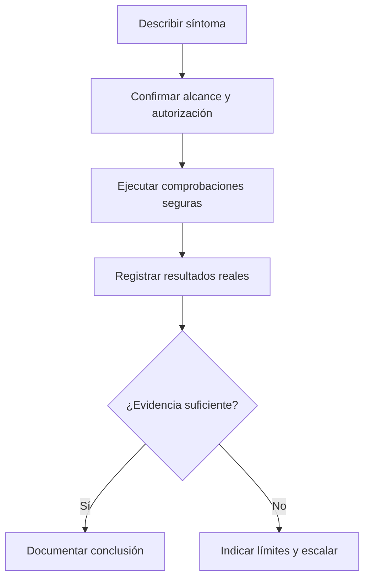

# 🖥️ Diagnóstico técnico | Soporte TI N1

**Portafolio práctico de aprendizaje · Windows · Redes básicas · Nivel inicial**

  

> **Propósito:** desarrollar procedimientos seguros, ejecutarlos en un equipo autorizado y documentar resultados observables. Las pruebas no realizadas se mantienen explícitamente pendientes.

## 🧭 Navegación
| Procedimiento | Herramientas previstas | Estado |
|---|---|---|
| [DIAG-001 — Rendimiento de Windows](procedimientos/DIAG-001-rendimiento-windows.md) | Administrador de tareas, Almacenamiento | Pendiente de ejecución |
| [DIAG-002 — Conectividad básica](procedimientos/DIAG-002-conectividad-windows.md) | `ipconfig`, `ping`, `nslookup` | Pendiente de ejecución |
| [Simulador de tickets](https://github.com/mujeresglobalesgestion-ops/help-desk-n1-simulador-tickets) | Atención por chat y correo | Proyecto independiente |

## 🔎 Método de diagnóstico

## 📋 Evidencias
Las tablas de cada procedimiento se completarán con resultados obtenidos durante la práctica. Se podrán añadir capturas **anonimizadas** cuando existan. No se publicarán direcciones IP internas, nombres de equipos, credenciales ni datos personales.

## 🎯 Competencias a demostrar
Observación de CPU, memoria y disco · almacenamiento · conectividad local · configuración IP · resolución DNS · documentación y escalamiento.

## 📌 Estado y cierre
**En desarrollo.** Procedimientos redactados; falta ejecutar y documentar ambos laboratorios en un equipo propio o autorizado. Un resultado inconcluso puede documentarse válidamente, sin inventar una reparación.

*Proyecto educativo independiente. No representa procedimientos oficiales de NTT DATA.*
